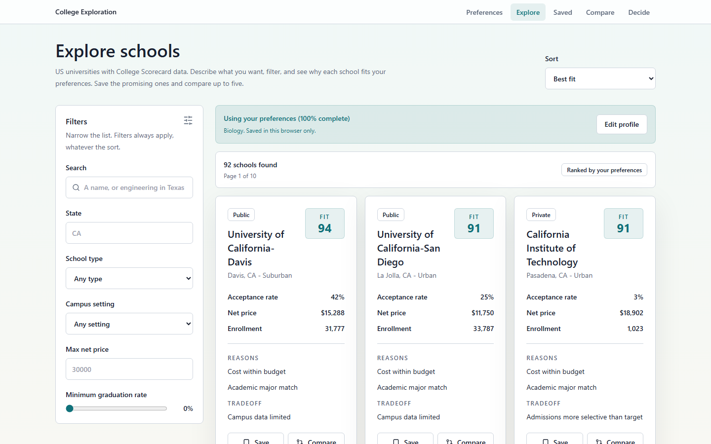
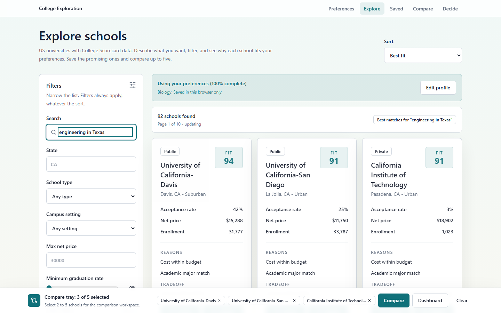
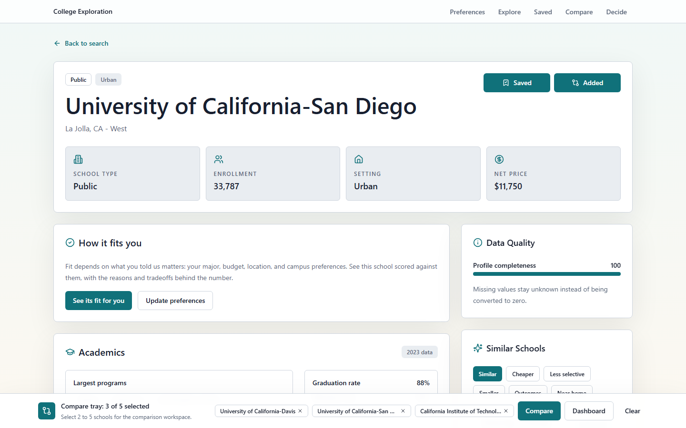
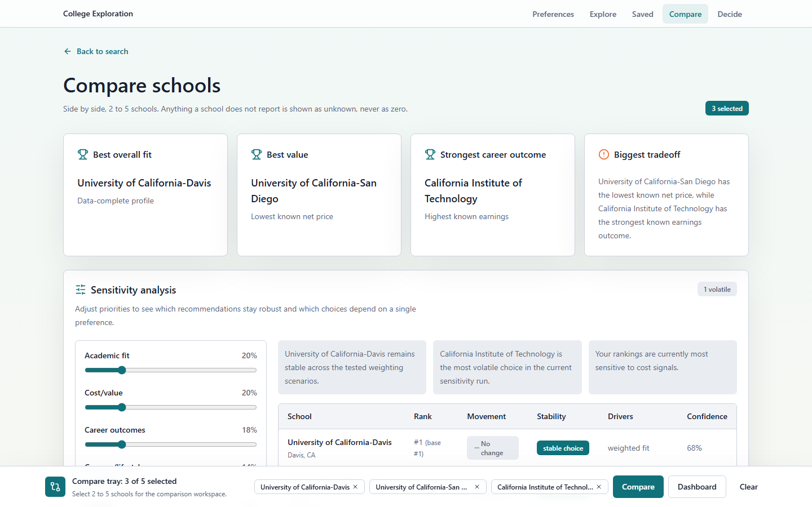
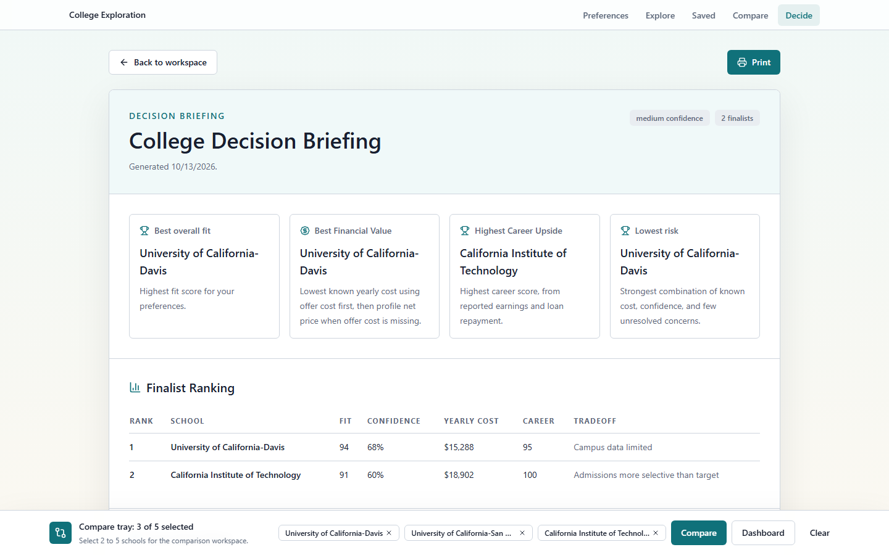
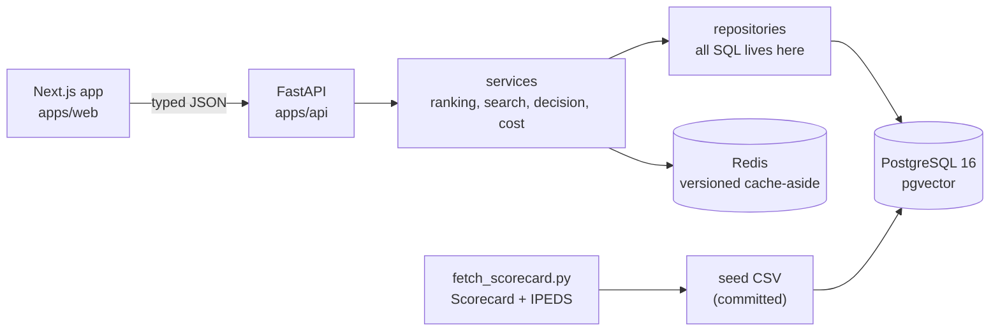

# College Exploration Platform

Rank US universities by what a student says matters, using federal College Scorecard and
IPEDS data, and show the reasons, tradeoffs, and data gaps behind every score.

[](https://github.com/codysj/College-Explorer/actions/workflows/ci.yml)
[](LICENSE)

Next.js 15 · TypeScript · FastAPI · PostgreSQL 16 · Redis · Playwright · pytest · Docker · AWS SAM



## What it does

- **Ranks schools against a student's own priorities.** A short quiz captures major,
  budget, location, campus, and admissions strategy. A deterministic engine scores six
  categories, returns a fit score and a separate data-confidence score, and explains each
  result with reason and tradeoff codes. No language model produces or alters any score.
- **Searches by description.** "Engineering in Texas" is matched with Postgres full-text
  search over generated school documents, filtered first and ordered by relevance, with the
  student's fit breaking ties.
- **Supports the decision, not only the search.** Save and compare up to five schools,
  stress-test the ranking by moving category weights, estimate four-year cost and loan
  repayment, and generate a printable decision briefing from the offers a student enters.
- **Treats missing data as unknown.** An unreported value lowers confidence; it is never
  scored as zero and never counted against a school.

| | |
| --- | --- |
|  |  |
|  |  |

Screenshots are captured from the real stack (real API, real database, production build) by
[`apps/web/media/capture.spec.ts`](apps/web/media/capture.spec.ts), so they can be regenerated
whenever the UI or data changes.

## Measured, not claimed

**Retrieval quality.** Search was evaluated with labeled queries whose relevance is defined by
attribute predicates, so every label is reproducible
([data/evaluation](data/evaluation/README.md)). Production full-text search, end-to-end
R-precision at 10:

| Query set | Queries | Score | 95% bootstrap CI |
| --- | ---: | ---: | ---: |
| Held-out, written after the design froze | 16 | 0.79 | 0.64-0.93 |
| Development (in-sample: the design was tuned on it) | 33 | 0.85 | 0.73-0.95 |
| Held-out, the pipeline before the v1.2 redesign | 16 | 0.46 | 0.31-0.61 |

The redesign (filter before the candidate limit, order by relevance, rebuilt documents)
clearly beats the original pipeline on unseen queries. Differences among the best retrievers,
including model2vec embeddings and hybrids, fall inside the intervals, so full-text was chosen
because it runs in the Postgres that is already deployed.

**Data.** 92 universities: the union of the 50 most selective and 50 largest US doctoral
universities by a documented, reproducible rule. College Scorecard supplies most fields and
IPEDS supplies the four Scorecard lacks. Each metric group is pinned to one reporting year,
shown in the UI, so a 2023 cost is never silently compared with 2020 earnings.

**Performance.** No latency or throughput figures are claimed yet. There is no public
deployment to measure, and local numbers on a laptop would say little about one.

## How it works



- **Typed end to end.** Pydantic models define every request and response. The frontend's
  types are generated from the exported OpenAPI schema, and CI fails if they drift.
- **Ranking is versioned.** Every scoring change bumps `RANKING_VERSION`, which is part of
  every cache key, and a snapshot test pins ranked order on the real corpus. Each formula
  and constant is listed in [docs/scoring-methodology.md](docs/scoring-methodology.md).
- **Stateless by design.** Accounts are not built yet, so the server keeps no per-visitor
  state. Saved schools and offers live in the browser and travel with each request.
- **Guarded for a public URL.** Expensive endpoints are rate limited by the
  platform-observed client IP, request bodies are bounded, OpenAPI docs are off outside
  development, and both containers run as non-root.

## Run it

**One command** (Docker): migrates, loads the 92-school snapshot on first start, and serves
the app at http://localhost:3000.

```bash
cp .env.example .env
docker compose up --build
```

**Local development** (Python 3.12, Node 22, Docker for the databases):

```bash
cp .env.example .env
docker compose up -d postgres redis
python3.12 -m venv .venv && source .venv/bin/activate   # Windows: .venv\Scripts\activate
pip install -r requirements.txt
cd apps/api && alembic upgrade head && python scripts/seed_database.py && python scripts/refresh_embeddings.py
uvicorn main:app --reload                                 # API on :8000, docs at /docs
cd apps/web && npm ci && npm run dev                      # second terminal, app on :3000
```

**Tests**

```bash
python -m pytest apps/api/tests                           # add TEST_DATABASE_URL to run the Postgres integration tests
cd apps/web && npm run lint && npm run typecheck && npm run test:e2e
python apps/api/scripts/evaluate_retrieval.py --per-query # retrieval evaluation
```

CI runs all of it on every push, against a real pgvector Postgres: migrations, an `alembic
check` that models match migrations, the seed, unit and integration tests, OpenAPI and type
drift checks, a Playwright suite including a full student journey, both Docker image builds,
a lint of the AWS SAM template, and dependency audits.

## Limitations

- **No public deployment yet.** The AWS Lambda, Neon, Upstash, and Vercel configuration is
  committed with a runbook ([docs/deployment.md](docs/deployment.md)), but it needs the
  operator's cloud accounts.
- **92 schools.** The engine and pipeline are corpus-agnostic, but the committed snapshot is
  deliberately small.
- **Some quiz answers can't be scored.** No public dataset covers internships, Greek life, or
  campus diversity, so those answers are saved but do not change scores. The quiz says so.
- **Hand-set scoring anchors.** Earnings saturate at $80,000 and debt at $18,000, and none of
  the anchors is fitted to student outcomes. All are documented so they can be challenged.
- **Similar schools has no labeled evaluation.** It still uses a 64-bucket hash embedding,
  and no quality claim is made for it.
- **No accounts.** Everything is stored in one browser. Authenticated persistence and shareable
  report links are on the [roadmap](docs/roadmap.md).

## Reviews and roadmap

- [docs/council-review.md](docs/council-review.md): a six-perspective review of the codebase
  (hiring manager, staff backend, frontend, security, data science, DevOps) and how each
  finding was resolved. It includes the bugs found along the way, such as a fetcher field
  name that had hidden Biology from every school.
- [docs/roadmap.md](docs/roadmap.md) and [tasks.md](tasks.md): the plan and a dated log of
  what was built and why.
- [docs/api-contract.md](docs/api-contract.md), [docs/architecture.md](docs/architecture.md),
  [docs/data-dictionary.md](docs/data-dictionary.md): reference documentation.

## About

College Explorer was first built by a three-person founding team and ran on AWS in 2024-2025,
where it served 7,600 unique users. This repository is a substantially rebuilt continuation of
that product; the usage figure belongs to the earlier deployment, not to this code.

Development uses AI coding agents under explicit project rules, kept in the repository in
[CLAUDE.md](CLAUDE.md) and [AGENTS.md](AGENTS.md): deterministic ranking only, no invented
numbers, parameterized SQL only, missing data never treated as zero. The design decisions,
scope, and review are the author's.

This is decision support, not admissions or financial advice.

Released under the [MIT License](LICENSE).
